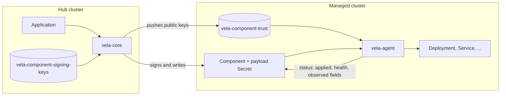

:::caution Alpha
Component dispatch is alpha in v1.13, behind the `EnableComponentDispatch` feature gate. The
`Component` API is `core.oam.dev/v1alpha1` and may change before beta.
:::

By default the hub applies an Application's resources to every cluster itself, through
cluster-gateway. That works, but the hub ends up doing everything: it holds the credentials,
it makes every write, and it has to stay reachable for a managed cluster to keep its state.

With **component dispatch**, the hub renders each component as it always has, then signs the
result and hands it to the cluster it belongs on as a `Component`. **vela-agent**, running on
that cluster, checks the signature, applies what's inside, keeps it applied, and reports back.
The Application looks the same from the outside: the same workflow, the same status, the same
`vela status`.

## How it works



For each component and each cluster it's placed on, the hub writes two objects into the
target namespace on that cluster:

- a **payload Secret**, `<component name>-payload`, holding the rendered resources;
- a **`Component`**, holding the revision, the target, the apply and health policies, the fields
  to report back, and the digest and index of the payload. The hub signs it with an Ed25519 key.

vela-agent applies a Component only if it's signed by a key the hub pushed to that cluster,
addressed to that cluster, and not older than what it already applied. The payload must also
match the signed digest. Anything else is refused, and the reason shows on the Component.
vela-agent tracks what it applied in the Component's own ResourceTrackers. It collects what a
new revision drops, corrects drift, and reports health and any fields other components read.

On the hub, vela-core runs vela-agent too, for components placed on the hub's own cluster.

## Before you start

- **KubeVela v1.13 or later**, on the hub and on every cluster you dispatch to.
- **Clusters joined to the hub** with `vela cluster join`, as for any multi-cluster delivery
  ([Multi-cluster delivery](../../case-studies/multi-cluster.md)).
- Only the `deploy` and `apply-component` workflow steps dispatch Components. Other steps that
  apply resources, such as `apply-object`, still apply them from the hub.
- The prism resource APIs, and VelaUX until it's built against v1.13, list a dispatched
  component's `Component` rather than the resources inside it. The `vela` CLI lists the resources
  (see [What's different](#whats-different)).

## Turn it on at the hub

Enable the feature gate on the hub's vela-core:

```shell
helm upgrade --install kubevela kubevela/vela-core -n vela-system --create-namespace \
  --set featureGates.enableComponentDispatch=true
```

On first start vela-core generates a signing key into `vela-system/vela-component-signing-keys`
and starts pushing its public half to every joined cluster, as
`vela-system/vela-component-trust`. Nothing changes for any Application until you annotate it.

If your components read each other with `$(component.<name>)`, keep
`featureGates.enableCelExpressions=true` on the hub as well, as you would without dispatch.

## Install vela-agent on a managed cluster

On each managed cluster, install the same chart as **vela-agent alone**:

```shell
helm upgrade --install kubevela kubevela/vela-core -n vela-system --create-namespace \
  --set featureGates.enableComponentDispatch=true \
  --set agent.only=true \
  --set agent.clusterName=prod-use1 \
  --set "agent.producers={kubernetes-admin}"
```

| Value | What it's for |
| --- | --- |
| `agent.only` | Installs vela-core as vela-agent and the Component webhook, and none of the hub's webhooks, definitions or add-ons. Needs `featureGates.enableComponentDispatch`, and the chart refuses to install without it. |
| `agent.clusterName` | This cluster's name **as the hub knows it**: the name you gave `vela cluster join`. vela-agent refuses a Component addressed to any other cluster. |
| `agent.producers` | Who may create a Component or change its spec, besides vela-core's own service account. Set it to the identity the hub joined the cluster with: usernames, or `group:<name>`. |

The hub writes Components with the credentials it joined the cluster with, so that identity has
to be a producer. To find it, run `kubectl auth whoami` with the kubeconfig you passed to
`vela cluster join`. On a kind cluster that's usually `kubernetes-admin`, and on k3d it's
`system:admin`.

:::note
Only a producer may create a Component or change its spec, whatever RBAC allows. Anyone RBAC lets
delete one may do so: without a signed tombstone from the hub, vela-agent leaves the Component's
resources where they are, and the hub writes the Component again on its next reconcile.
:::

Every CRD in the chart still installs, because Helm can't skip some of them, but vela-agent only
uses `Component` and `ResourceTracker`.

Then join the cluster from the hub, under the same name:

```shell
vela cluster join prod-use1.kubeconfig --name prod-use1
```

Within a minute the hub pushes its keys to the new cluster, and vela-agent can apply anything
signed with them.

## Dispatch an Application

Annotate the Application:

```yaml
apiVersion: core.oam.dev/v1beta1
kind: Application
metadata:
  name: shop
  annotations:
    app.oam.dev/dispatch: component
spec:
  components:
    - name: web
      type: webservice
      properties:
        image: nginx:1.27
  policies:
    - name: prod
      type: topology
      properties:
        clusters: ["prod-use1"]
        namespace: shop
```

The workflow runs as usual. Instead of applying `web`'s Deployment to `prod-use1`, the `deploy`
step writes a Component there:

```shell
$ kubectl get components -n shop        # against prod-use1
NAME                          CLUSTER     REVISION   OBSERVED   HEALTHY   AGE
shop-web-prod-use1-3f9c2a1e   prod-use1   1          1          true      40s
```

`REVISION` is what the hub last dispatched and `OBSERVED` is what vela-agent last applied. A
Component is named `<app>-<component>[-<replica key>]-<cluster>`, trimmed to fit a label value,
then 8 characters of a hash over every part, so two placements never share a name.

The Application's status reports the component's health from what vela-agent found, as it
would in-process. Only the hub changes a Component. Edit the Application, and the next revision
goes out.

### What's different

| | In-process | Dispatched |
| --- | --- | --- |
| Who applies | the hub, through cluster-gateway | vela-agent, on the cluster |
| PostDispatch traits | applied once the workload is healthy | dispatched as the Component's next revision once vela-agent reports the workload healthy |
| `$(component.<name>)` reads | read from the live resource | answered from what vela-agent observed and reported. The hub asks it for exactly the fields that are read, and values from Secrets come back sealed, so only the hub can open them |
| Control-plane-only traits (`controlPlaneOnly: true`) | applied on the hub | dispatched to a Component of their own on the hub, one per placement, ending `-cp` |
| Removing a component, deleting the app | the hub deletes the resources | the hub writes a signed tombstone; vela-agent collects everything, then the Component goes |
| Listing resources (`vela status --tree`, `--endpoint`, `vela logs`, `exec`, `port-forward`) | from the Application's ResourceTrackers | from each Component's `status.resources`, which vela-agent fills with what it applied. The payload Secret isn't listed |

## Switching an existing Application

Adding the annotation to an Application that's already running hands its resources over to
vela-agent **in place**: nothing is deleted or recreated, and every resource keeps its UID. The
first Component revision adopts what the Application applied, and once vela-agent has applied
it everywhere, the Application stops tracking those resources itself.

Removing the annotation hands them back the same way, then retires the Components.

While a handover is in progress, the Application has a `Handover` condition that says what it's
waiting on:

```shell
$ kubectl get app shop -o jsonpath='{.status.conditions[?(@.type=="Handover")].message}'
component web: waiting for vela-agent to adopt its resources
```

## Keys and rotation

| Secret | Where | Holds |
| --- | --- | --- |
| `vela-component-signing-keys` | hub, `vela-system` | the hub's private signing keys, and which one is active |
| `vela-component-trust` | every cluster, `vela-system` | the public half of each signing key, and the matching sealing keys |

The hub keeps every cluster's trust Secret equal to its own keys. It checks each one about once
a minute, puts back anything that's been changed, and records a `ForeignTrustedKey` event on
the signing keys Secret if it finds a key it didn't issue. vela-agent watches the trust Secret,
so a Component refused for an unknown key goes ahead as soon as the key arrives.

To rotate, annotate the signing keys Secret on the hub:

```shell
kubectl -n vela-system annotate secret vela-component-signing-keys \
  component.oam.dev/rotate-signing-key="$(date -u +%FT%TZ)"
```

1. On its next pass, the hub adds a key, makes it the active one, removes the annotation and
   pushes both keys to every cluster (event `RotatedSigningKey`).
2. Each dispatched Application re-signs its Components with the new key straight away, at the
   same revision.
3. On a later pass, a key that isn't active, and that no Component on any cluster is signed
   with or has sealed values to, is retired: deleted from the signing keys and dropped from
   every cluster's trust (event `RetiredSigningKey`). If the hub can't list Components on a
   cluster, it keeps every key until it can.

### Rotate on a schedule

To have the hub rotate on its own, give the key a maximum age:

```shell
helm upgrade kubevela kubevela/vela-core -n vela-system --reset-then-reuse-values \
  --set componentDispatch.signingKeyMaxAge=2160h
```

Once the active key has been active for longer, the hub annotates the signing keys Secret
itself, and the rotation runs exactly as above. The Secret's `component.oam.dev/active-since`
annotation says when the active key became active. A key from before the schedule was set has
no such annotation, so its clock starts when the hub first sees it, and turning the schedule on
never rotates straight away.

:::note
A cluster the hub can't reach blocks retirement for every key. If one stays unreachable across
several scheduled rotations, the hub keeps adding keys and retires none of them until it can
list that cluster again. Remove a cluster you no longer use with `vela cluster detach`.
:::

### When old keys don't retire

The hub holds the active key and, during a rotation, the one it replaced. If it holds more, it
records a `SigningKeysPilingUp` warning on `vela-component-signing-keys`, naming each old key
and the Components still carrying it, or the cluster it couldn't list:

```shell
kubectl -n vela-system get events --field-selector involvedObject.name=vela-component-signing-keys
```

Two metrics track the same: `kubevela_component_signing_keys` (more than 2 for long means
retirement is held up) and `kubevela_component_signing_key_age_seconds`.

### Revoke a key

If a signing key may have leaked, don't wait for a rotation to retire it. Revoke it:

```shell
kubectl -n vela-system annotate secret vela-component-signing-keys \
  component.oam.dev/revoke-signing-key=hub-20261122-6a27ef
```

Within a minute, the hub deletes the key and every cluster stops trusting it, whatever still
carries it. If it was the active key, the hub makes a new one active first (event
`RevokedSigningKey`). Every dispatched Application then signs its Components again with the
active key.

Until its Component is signed again, vela-agent refuses changes to it (`UntrustedKey`) and leaves
its resources as they are. Values sealed to the revoked key can't be read by the hub until
vela-agent observes them again, so a `$(component.<name>)` read of a Secret's value may wait a
little. If you name a key the hub doesn't hold, it says so with a `RevokeSigningKeyFailed`
warning.

## Troubleshooting

### A Component is refused

vela-agent records why on the Component's `Verified` condition, and as an event:

```shell
kubectl get component <name> -n <namespace> -o jsonpath='{.status.conditions[?(@.type=="Verified")]}'
```

| Reason | Means | Usually |
| --- | --- | --- |
| `UntrustedKey` | signed by a key this cluster doesn't trust | the hub hasn't pushed its keys here yet. Check that the cluster is joined, under the name in `agent.clusterName` |
| `Unsigned`, `BadSignature` | no signature, or the spec changed after signing | something other than the hub edited the Component |
| `WrongCluster` | addressed to another cluster | `agent.clusterName` doesn't match the name the cluster was joined under |
| `StaleRevision` | older than a revision already applied | an old copy written back by hand or a restore. The hub's next revision replaces it |
| `PayloadMissing`, `PayloadMismatch` | the payload Secret is missing, or doesn't match the signed digest | usually brief, while the hub writes a new revision. vela-agent looks again within seconds |

If the `Applied` condition has the reason `StaleTracker`, a ResourceTracker under the
Component's name was left by an earlier Component of the same name. The message names it. Decide
what becomes of the resources it records, delete it, and the Component applies.

### The Application says it's waiting on vela-agent

If a Component isn't applied within two minutes, the Application says so on the workflow step,
on the component's service status, and as a `ComponentNotApplied` event, and it keeps waiting:

```
waiting since 2026-11-22T12:00:00Z for anything on cluster prod-use1 to reconcile Component shop/shop-web-prod-use1-3f9c2a1e: is vela-agent running there?
```

That one means nothing on the cluster has ever reconciled the Component. Check that vela-agent
is installed and running there, with `featureGates.enableComponentDispatch` on.

```
waiting since 2026-11-22T12:00:00Z for vela-agent on cluster prod-use1 to apply revision 4 of Component shop/shop-web-prod-use1-3f9c2a1e (last applied 3)
```

That one means vela-agent has applied this Component before, but not the latest revision. Look
at the Component's `Verified` and `Applied` conditions, and at vela-agent's logs.

Change the wait with vela-core's `--component-reconciler-timeout` flag (default `2m`).

## Reference

| Setting | Where | Default |
| --- | --- | --- |
| `featureGates.enableComponentDispatch` (`--feature-gates=EnableComponentDispatch=true`) | hub and managed clusters | `false` |
| `agent.only` (`--agent-only`) | managed clusters | `false` |
| `agent.clusterName` (`--agent-cluster-name`) | managed clusters | `local` on the hub |
| `agent.producers` (`--component-producers`) | managed clusters | vela-core's own service account |
| `--component-reconciler-timeout` | hub | `2m` |
| `componentDispatch.signingKeyMaxAge` (`--component-signing-key-max-age`) | hub | empty: rotate only when asked |

| Name | Kind | On |
| --- | --- | --- |
| `app.oam.dev/dispatch: component` | annotation | Application |
| `component.oam.dev/rotate-signing-key` | annotation | `vela-component-signing-keys`, asks for a rotation |
| `component.oam.dev/revoke-signing-key` | annotation | `vela-component-signing-keys`, names a key to stop trusting at once |
| `component.oam.dev/active-since` | annotation | `vela-component-signing-keys`, when the active key became active |
| `component.oam.dev/removed-keys` | annotation | `vela-component-signing-keys`, keys the hub removed that a cluster may still trust |
| `component.oam.dev/dispatched-at` | annotation | Component, when the hub wrote its current revision |
| `component.oam.dev/cluster` | label | Component, the cluster it's addressed to |
| `component.oam.dev/control-plane-for` | label | hub Component holding control-plane-only traits, the cluster it serves |
| `app.oam.dev/name`, `app.oam.dev/component` | labels | Component |
